# Sistema de Gestión de Inventario — API REST + Flutter

**Electiva Profesional I — Desarrollo de Aplicaciones Móviles**  
**Segundo Parcial Práctico + Taller 2: Autenticación JWT y Protección de Servicios — UCEVA**  
**Estudiante:** Johan Eliu Salgado Castro — **Código:** 230232033  

---

## 1. Descripción General de la Solución

Este proyecto corresponde al desarrollo de una solución integral para la administración y control de inventario de productos de un establecimiento comercial, complementada con un sistema completo de autenticación y autorización basado en JSON Web Tokens (JWT). La solución consta de dos componentes principales, funcionales y desacoplados:

1. **Backend (API REST):** Desarrollado con **Node.js** y **Express**, utilizando **SQLite** como motor de persistencia relacional en archivo local (`inventario.db`). Proporciona endpoints de autenticación (`/api/auth/login`, `/api/auth/perfil`), CRUD completo de productos protegido mediante middleware de verificación de tokens Bearer, contraseñas con hash criptográfico (**bcryptjs**), generación de JWT (**jsonwebtoken**) y validaciones de reglas de negocio con manejo adecuado de códigos de estado HTTP (200, 201, 401, 404, 422, 500).
2. **Frontend (Aplicación Móvil Flutter):** Desarrollado con **Flutter**, estructurado bajo una separación de responsabilidades (modelos, servicios, router y pantallas). Consume la API REST mediante un cliente compartido **Dio** con interceptor para adjuntar el encabezado `Authorization: Bearer <token>`, maneja redirección reactiva con **go_router**, almacena el token de acceso en **flutter_secure_storage** y datos no sensibles en **shared_preferences**, incluye pantalla de inicio de sesión, pantalla de estado de sesión, barra de navegación inferior de 3 opciones y Dashboard con métricas calculadas en tiempo real.

**Despliegue:** La API y la aplicación se ejecutan de forma local en el entorno de desarrollo.

---

## 2. Tecnologías Utilizadas

### Backend
* **Entorno de ejecución:** Node.js (v18 o superior)
* **Framework web:** Express.js 4.x
* **Base de datos:** SQLite3 (tablas `productos` y `usuarios` creadas e inicializadas automáticamente con datos semilla)
* **Seguridad y Criptografía:** `bcryptjs` para el hash seguro de contraseñas
* **Autenticación:** `jsonwebtoken` para emisión y validación de tokens JWT
* **CORS:** middleware para permitir peticiones desde Flutter (móvil, emulador, web)
* **Dotenv:** carga de variables de entorno desde `.env` (`PORT`, `JWT_SECRET`, `JWT_EXPIRES_IN`)

### Frontend (Móvil)
* **Framework:** Flutter 3.x / Dart 3.x
* **Cliente HTTP:** `dio` (cliente único compartido con interceptores de solicitud y error)
* **Enrutamiento:** `go_router` (rutas declarativas con control de acceso y `redirect` reactivo)
* **Almacenamiento Seguro:** `flutter_secure_storage` (almacena el `access_token` cifrado)
* **Almacenamiento Local:** `shared_preferences` (almacena nombre y correo del usuario)
* **Variables de entorno:** `flutter_dotenv` (URL base configurable)
* **Formato de moneda y números:** `intl`
* **Diseño:** Material Design 3

---

## 3. Estructura del Repositorio

```text
inventario-flutter-api/
│
├── backend/                               # Proyecto de la API REST
│   ├── middleware/
│   │   └── auth.js                        # Middleware verificarToken (Bearer JWT)
│   ├── routes/
│   │   ├── auth.js                        # Endpoints de login y perfil de usuario
│   │   └── productos.js                   # Endpoints CRUD protegidos con validaciones
│   ├── database.js                        # Conexión SQLite, esquemas y semillas (usuarios y productos)
│   ├── server.js                          # Servidor Express principal y rutas
│   ├── peticiones.http                    # Pruebas HTTP completas (login, errores 401, CRUD protegido)
│   ├── Postman_Coleccion_Inventario.json  # Colección exportada para Postman con variables
│   ├── package.json                       # Dependencias y scripts de Node
│   ├── .env.example                       # Plantilla de variables de entorno (PORT, JWT_SECRET, JWT_EXPIRES_IN)
│   ├── .gitignore                         # Exclusión de node_modules, .env y archivos locales
│   └── .env                               # Variables locales (no versionado)
│
├── frontend/                              # Proyecto de la aplicación Flutter
│   ├── lib/
│   │   ├── models/
│   │   │   ├── producto.dart              # Modelo Producto (fromJson, toJson, cálculos)
│   │   │   └── usuario.dart               # Modelo Usuario (fromJson, toJson)
│   │   ├── services/
│   │   │   ├── api_client.dart            # Cliente Dio único compartido con interceptor Bearer y 401
│   │   │   ├── auth_service.dart          # Servicio de autenticación, login, logout y perfil
│   │   │   ├── storage_service.dart       # Gestor de Secure Storage y SharedPreferences
│   │   │   └── producto_service.dart      # Consumo HTTP de productos usando ApiClient compartido
│   │   ├── router/
│   │   │   └── app_router.dart            # Enrutador go_router con refreshListenable y redirect
│   │   ├── screens/
│   │   │   ├── splash_screen.dart         # Pantalla de verificación inicial de sesión
│   │   │   ├── login_screen.dart          # Formulario de inicio de sesión y manejo de errores
│   │   │   ├── main_navigation_screen.dart# Contenedor con barra de navegación inferior (3 pestañas)
│   │   │   ├── dashboard_screen.dart      # Dashboard con indicadores y métricas
│   │   │   ├── productos_screen.dart      # Listado de productos y acciones CRUD
│   │   │   ├── producto_detalle_screen.dart # Detalle de un producto
│   │   │   ├── producto_form_screen.dart  # Formulario de registro y edición
│   │   │   └── sesion_screen.dart         # Vista de datos de usuario, estado y botón cerrar sesión
│   │   └── main.dart                      # Punto de entrada, verificación de sesión y tema M3
│   ├── test/
│   │   └── widget_test.dart               # Pruebas unitarias de modelos Producto y Usuario
│   ├── .env.example                       # Plantilla de variables de entorno (API_BASE_URL)
│   ├── .gitignore                         # Exclusión de temporales, build y .env
│   ├── .env                               # URL base local (no versionado)
│   └── pubspec.yaml                       # Dependencias y configuración de assets
│
└── README.md                              # Documentación general de la solución
```

---

## 4. Descripción de la Base de Datos

Se utiliza una base de datos relacional SQLite almacenada en el archivo `backend/inventario.db`. Contiene dos tablas principales: `usuarios` y `productos`.

### Tabla `usuarios`

| Campo | Tipo | Restricciones | Descripción |
| :--- | :--- | :--- | :--- |
| `id` | INTEGER | PRIMARY KEY AUTOINCREMENT | Identificador único del usuario |
| `nombre` | TEXT | NOT NULL | Nombre completo del usuario |
| `correo` | TEXT | NOT NULL UNIQUE | Correo electrónico de acceso |
| `password` | TEXT | NOT NULL | Contraseña almacenada en hash con salt (bcryptjs) |

> Al iniciar el servidor por primera vez, si la tabla `usuarios` está vacía se crea automáticamente un **usuario de prueba semilla**:
> * **Correo:** `admin@inventario.com`
> * **Contraseña:** `admin123` (almacenada mediante hash seguro, nunca en texto plano)

### Tabla `productos`

| Campo | Tipo | Restricciones | Descripción |
| :--- | :--- | :--- | :--- |
| `id` | INTEGER | PRIMARY KEY AUTOINCREMENT | Identificador único y autogenerado |
| `nombre` | TEXT | NOT NULL | Nombre comercial del producto |
| `codigo` | TEXT | NOT NULL UNIQUE | Código único de referencia |
| `descripcion` | TEXT | NULLABLE | Descripción adicional (opcional) |
| `precio` | REAL | NOT NULL | Precio unitario (debe ser mayor a 0) |
| `cantidad` | INTEGER | NOT NULL | Unidades disponibles (debe ser mayor o igual a 0) |
| `categoria` | TEXT | NOT NULL | Categoría del producto |

> Al ejecutar el servidor por primera vez, si la tabla está vacía se cargan automáticamente **12 productos de prueba** de diversas categorías.

---

## 5. Endpoints de la API REST

### Endpoints de Autenticación (`/api/auth`)

| Método | Endpoint | Acceso | Descripción | Códigos HTTP |
| :--- | :--- | :--- | :--- | :--- |
| **POST** | `/api/auth/login` | Público | Valida credenciales (`correo`, `password`) y genera un token JWT. | `200`, `401`, `500` |
| **GET** | `/api/auth/perfil` | Protegido | Devuelve la información del usuario autenticado a partir del token. | `200`, `401`, `500` |

### Endpoints de Productos (`/api/productos`) — Protegidos con Bearer JWT

Todas las rutas de `/api/productos` requieren el encabezado `Authorization: Bearer <token>`. Si el token falta, es inválido o expiró, la API responde con `401 Unauthorized`.

| Método | Endpoint | Acceso | Descripción | Códigos HTTP |
| :--- | :--- | :--- | :--- | :--- |
| **GET** | `/api/productos` | Protegido | Lista todos los productos, ordenados del más reciente al más antiguo. | `200`, `401`, `500` |
| **GET** | `/api/productos/:id` | Protegido | Consulta el detalle de un producto por su ID. | `200`, `401`, `404`, `500` |
| **POST** | `/api/productos` | Protegido | Registra un nuevo producto validando campos obligatorios y reglas numéricas. | `201`, `401`, `422`, `500` |
| **PUT** | `/api/productos/:id` | Protegido | Actualiza un producto existente comprobando que el código no colisione. | `200`, `401`, `404`, `422`, `500` |
| **DELETE** | `/api/productos/:id` | Protegido | Elimina un producto tras verificar su existencia. | `200`, `401`, `404`, `500` |

---

## 6. Autenticación JWT y Almacenamiento Seguro

### 6.1. ¿Cómo funciona la autenticación?

```text
[Flutter Client]                                          [Node.js Backend]
       |                                                          |
       |----- POST /api/auth/login {correo, password} ----------->|
       |                                                          |-- Busca usuario por correo
       |                                                          |-- Valida hash (bcryptjs.compareSync)
       |                                                          |-- Genera JWT firmado (jsonwebtoken)
       |<---- 200 OK {token, usuario: {id, nombre, correo}} ------|
       |
       |-- Guarda 'access_token' en FlutterSecureStorage
       |-- Guarda datos de usuario en SharedPreferences
       |-- Notifica cambio de sesión (ChangeNotifier)
       |-- go_router redirige automáticamente al Dashboard
       |
       |===== Petición a Endpoint Protegido (ej. GET /api/productos) =====
       |
       |-- Interceptor Dio lee token de FlutterSecureStorage
       |-- Agrega encabezado: "Authorization: Bearer <token>"
       |----- GET /api/productos -------------------------------->|
       |                                                          |-- Middleware verificarToken
       |                                                          |-- Valida firma y expiración
       |<---- 200 OK [lista de productos] ------------------------|
       |
       |===== En caso de Token Expirado o Inválido (401) =====
       |                                                          |
       |<---- 401 Unauthorized {"error": "..."} ------------------|
       |-- Interceptor Dio detecta 401 en endpoint protegido
       |-- Limpia Secure Storage y SharedPreferences
       |-- Notifica cambio de sesión
       |-- go_router redirige automáticamente a /login
```

### 6.2. Estrategia de Almacenamiento Local

* **`flutter_secure_storage`:** Almacena exclusivamente el `access_token` JWT. Utiliza el KeyStore de Android y el Keychain de iOS, garantizando cifrado en reposo por hardware/sistema operativo.
* **`shared_preferences`:** Almacena información pública y no sensible del usuario (`usuario_id`, `usuario_nombre`, `usuario_correo`).
* **Regla estricta:** La contraseña nunca se almacena localmente y el token nunca se guarda en SharedPreferences sin cifrar.

### 6.3. Variables de Entorno

#### Backend (`backend/.env`)
```env
PORT=3000
JWT_SECRET=genera_una_clave_secreta_segura_aqui_no_uses_este_texto
JWT_EXPIRES_IN=1h
```

Para generar una clave secreta segura propia de 256 bits (32 bytes en formato hexadecimal), puedes ejecutar en la terminal:
```bash
node -e "console.log(require('crypto').randomBytes(32).toString('hex'))"
```

#### Frontend (`frontend/.env`)
```env
API_BASE_URL=http://localhost:3000/api
```

> **Nota de seguridad:** Los archivos `.env` reales están excluidos de Git en sus respectivos archivos `.gitignore`. Únicamente se versionan las plantillas `.env.example`. Además, el servidor backend valida al iniciar que la variable `JWT_SECRET` se encuentre definida en el archivo `.env`; si falta, el proceso se detiene con un mensaje de error.

---

## 7. Instrucciones de Instalación y Ejecución

### Prerrequisitos
* Node.js v18 o superior.
* Flutter SDK 3.x o superior, configurado en el PATH.
* Android Studio con emulador creado o dispositivo físico (en caso de ejecutar en Android).

---

### Paso 1: Configurar y ejecutar el Backend

1. Abre una terminal de PowerShell y entra a la carpeta `backend`:
   ```powershell
   cd backend
   ```
2. Instala las dependencias de Node:
   ```powershell
   npm install
   ```
3. Crea el archivo `.env` a partir de la plantilla y asigna una clave secreta a `JWT_SECRET`:
   ```powershell
   Copy-Item .env.example .env
   ```
   Puedes generar una clave secreta aleatoria ejecutando:
   ```powershell
   node -e "console.log(require('crypto').randomBytes(32).toString('hex'))"
   ```
   Copia la clave generada y asígnala a `JWT_SECRET` en `backend/.env`.
4. Inicia el servidor:
   ```powershell
   npm start
   # O en modo desarrollo con recarga automática:
   npm run dev
   ```
5. La consola mostrará: `Servidor iniciado en puerto 3000`. Mantén esta terminal abierta.

---

### Paso 2: Configurar y ejecutar la Aplicación Flutter

1. Abre otra terminal de PowerShell y entra a la carpeta `frontend`:
   ```powershell
   cd frontend
   ```
2. Crea el archivo `.env` a partir de la plantilla:
   ```powershell
   Copy-Item .env.example .env
   ```
3. Edita `frontend/.env` según el dispositivo en el que vayas a ejecutar la app:
   * **Emulador Android Studio:**
     ```env
     API_BASE_URL=http://10.0.2.2:3000/api
     ```
   * **Windows Desktop o Google Chrome:**
     ```env
     API_BASE_URL=http://localhost:3000/api
     ```
   * **Celular físico (conectado a la misma red WiFi que el computador):**
     ```env
     API_BASE_URL=http://TU_IP_LOCAL:3000/api
     ```
4. Instala las dependencias de Flutter:
   ```powershell
   flutter pub get
   ```
5. Ejecuta la aplicación:
   ```powershell
   # Ver dispositivos disponibles
   flutter devices

   # Ejecutar en el dispositivo seleccionado
   flutter run -d <id-del-dispositivo>
   ```

---

## 8. Credenciales de Demostración

Para iniciar sesión en la aplicación o probar la API:

* **Correo electrónico:** `admin@inventario.com`
* **Contraseña:** `admin123`
* **Rol:** Administrador

---

## 9. Checklist de Pruebas Obligatorias (Los 7 Escenarios del Taller)

A continuación se detalla la lista de verificación para demostrar el funcionamiento completo del sistema integrado:

- [x] **1. Acceso sin autenticación:** Al abrir la aplicación sin sesión activa o intentar navegar directamente a una ruta protegida, el sistema redirige automáticamente a la pantalla de Login (`/login`), restringiendo el acceso al Dashboard y a los productos.
- [x] **2. Credenciales incorrectas:** Al ingresar un correo o contraseña equivocados en la pantalla de Login, se muestra un mensaje de error claro en pantalla (`Credenciales incorrectas` o `Error 401`), impidiendo el acceso.
- [x] **3. Inicio de sesión correcto:** Al ingresar `admin@inventario.com` y `admin123`, el backend genera el token JWT (200 OK), el cliente lo almacena en Secure Storage, guarda el perfil en SharedPreferences y `go_router` redirige inmediatamente al Dashboard principal.
- [x] **4. Consumo de servicios protegidos:** Una vez autenticado, todas las operaciones CRUD (listar productos, ver detalle, crear un nuevo producto, editar y eliminar) envían automáticamente el encabezado `Authorization: Bearer <token>` mediante el interceptor de Dio y se completan exitosamente.
- [x] **5. Persistencia de sesión:** Al cerrar por completo la aplicación y volverla a abrir, el cliente lee el token guardado en Secure Storage, valida su vigencia llamando a `GET /api/auth/perfil` mientras muestra un indicador de carga (`SplashScreen`), y accede directamente al Dashboard sin requerir iniciar sesión nuevamente.
- [x] **6. Validación desde el backend:** Al realizar una petición directa (mediante PowerShell, curl o Postman) a un endpoint protegido como `GET /api/productos` sin encabezado Authorization, con un token falso o con un token expirado, el backend rechaza la solicitud respondiendo con código HTTP `401 Unauthorized` y su respectivo mensaje de error.
- [x] **7. Cierre de sesión:** Al ingresar a la pestaña de **Sesión** en la barra inferior y presionar el botón **Cerrar Sesión**, se eliminan el token de Flutter Secure Storage y los datos de SharedPreferences, y la aplicación redirige de inmediato a la pantalla de Login, impidiendo el acceso a cualquier funcionalidad protegida.

---

## 10. Control de Versiones y GitFlow

El proyecto implementa el flujo de trabajo GitFlow:
* **`main`:** Rama principal de producción con versiones estables y probadas.
* **`dev`:** Rama base de integración y desarrollo.
* **`feature/taller_jwt`:** Rama de trabajo para la implementación de autenticación JWT y protección de servicios.

Commits semánticos utilizados:
* `chore:` tareas de configuración, exclusión de archivos `.env`.
* `feat(backend):` funcionalidades de autenticación JWT, usuarios y middleware.
* `feat(frontend):` pantallas de login y sesión, almacenamiento seguro, interceptor y router.
* `docs:` actualización completa de la documentación técnica del taller.

---

## 11. Capturas de Pantalla

### Dashboard
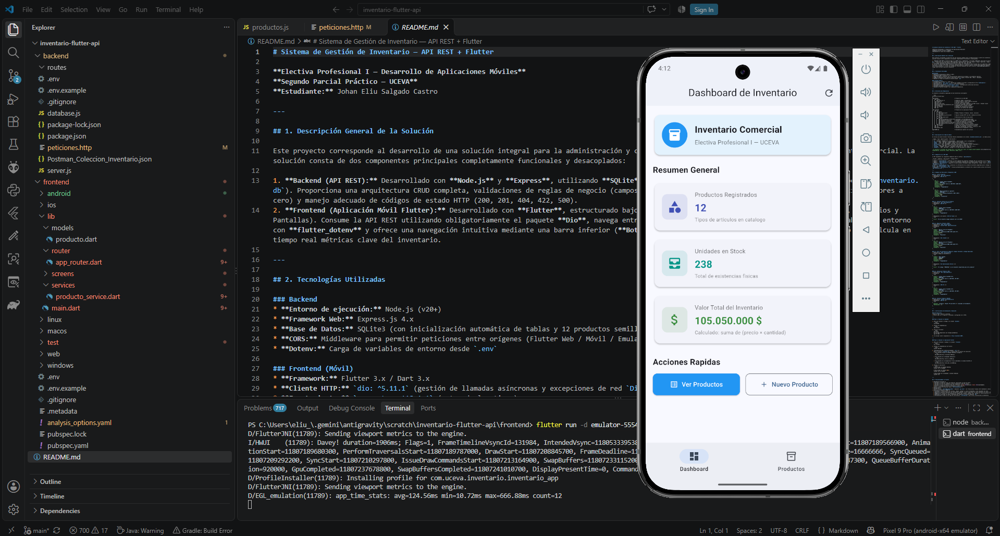

### Listado de productos
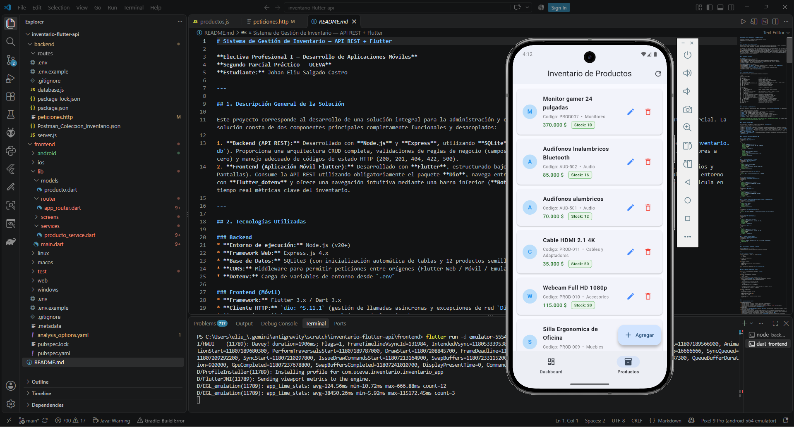

### Detalle de un producto
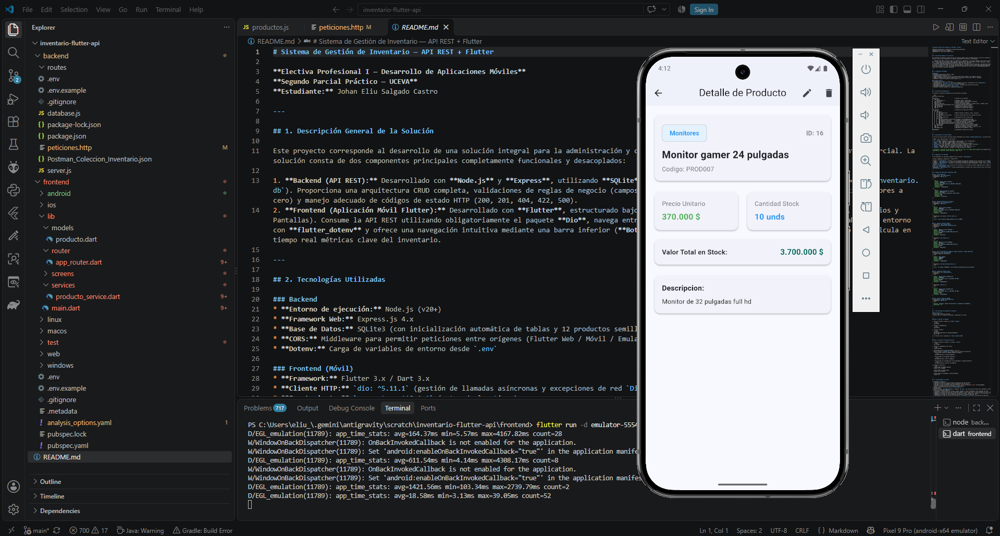

### Registro de producto
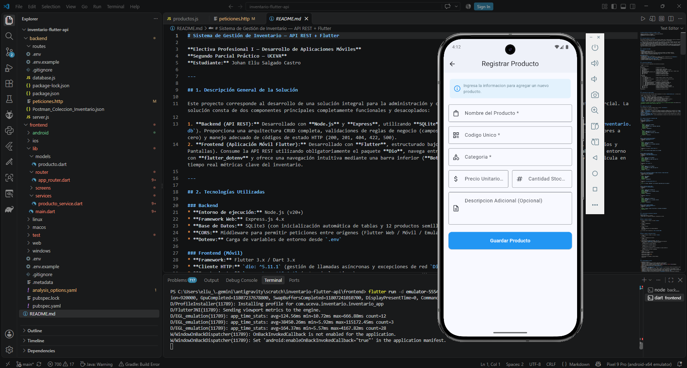

### Validación del formulario
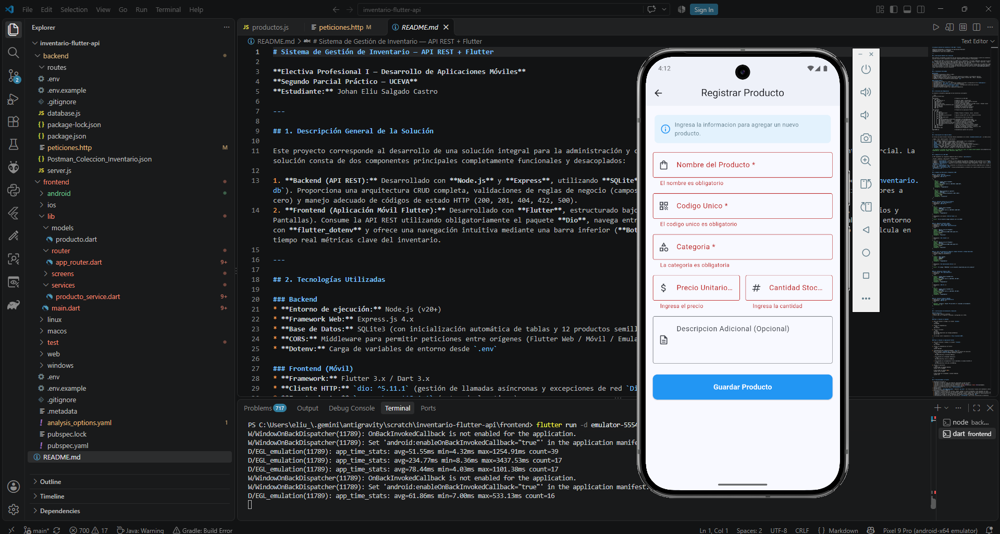

### Confirmación de eliminación
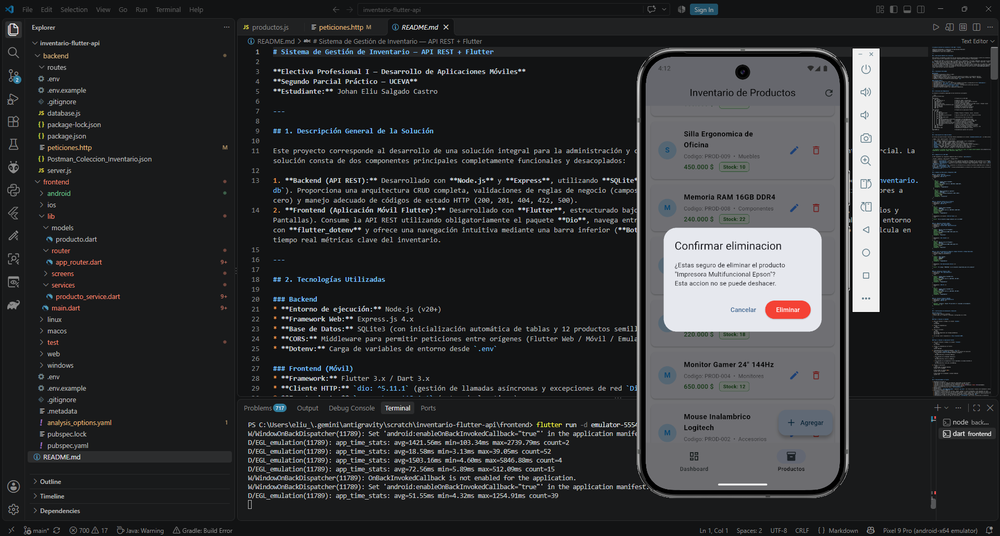

---

## 12. Capturas del Taller 2: Autenticación JWT

### Acceso sin autenticación (escenario 1)
Al abrir la aplicación sin sesión solo se muestra el login.
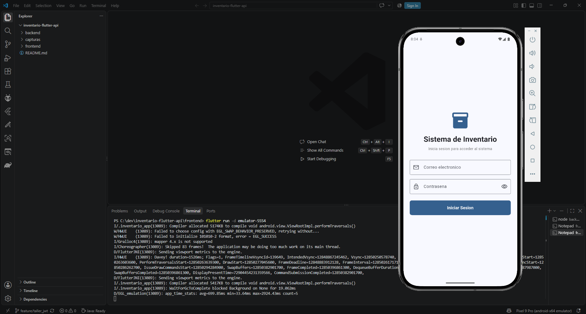

### Credenciales incorrectas (escenario 2)
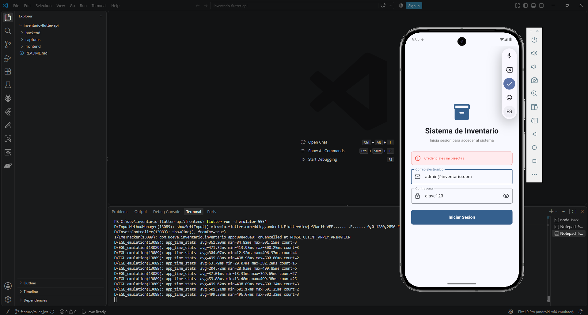

### Inicio de sesión correcto (escenario 3)
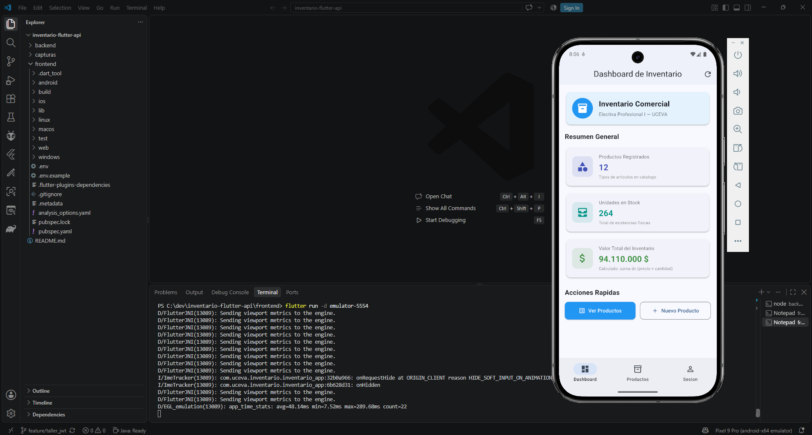

### Consumo de servicios protegidos (escenario 4)
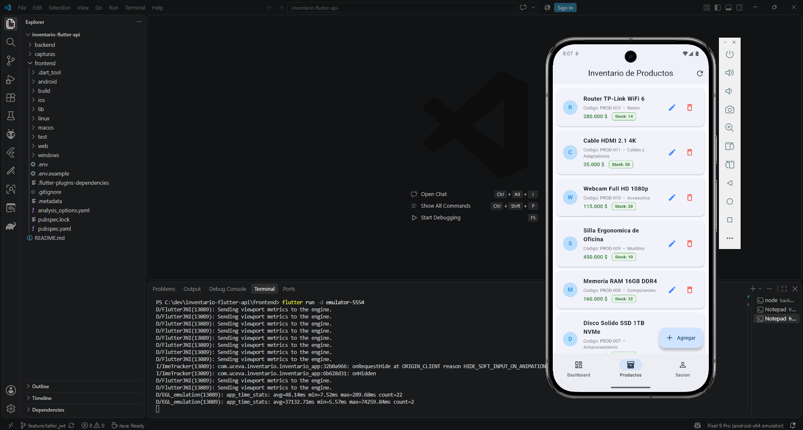
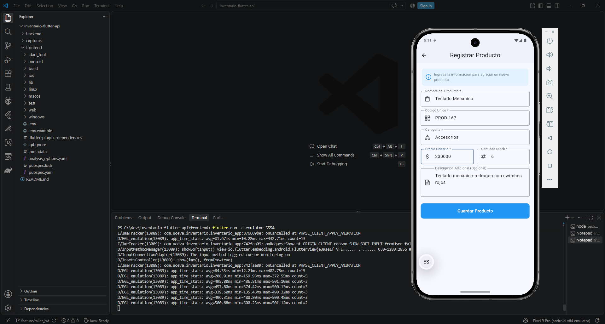

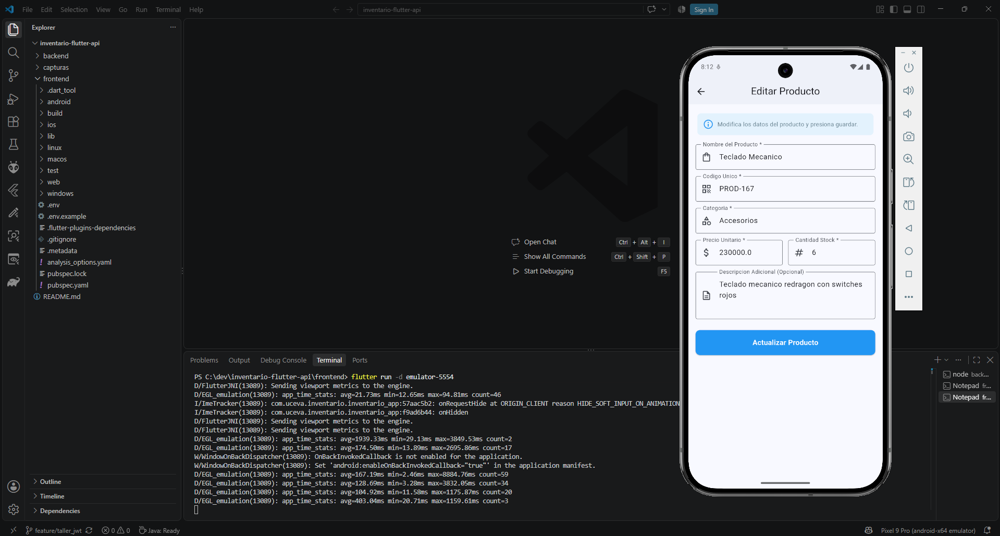
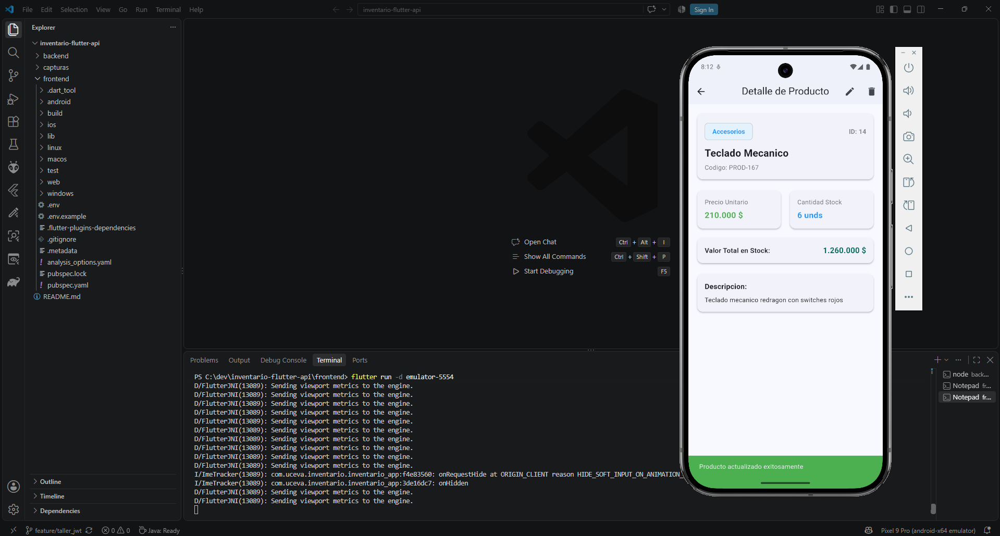
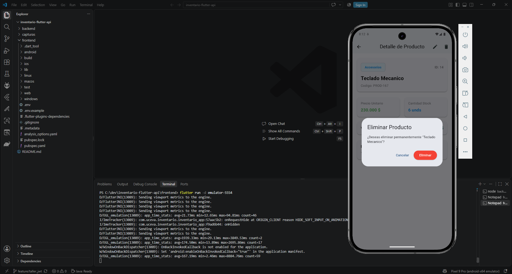
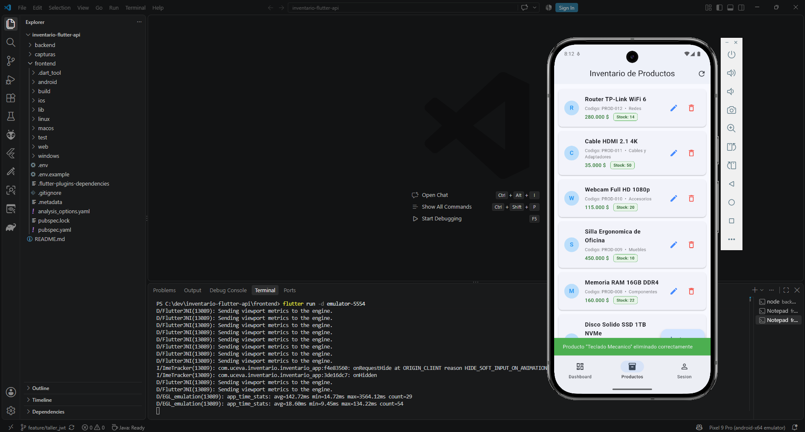

### Pantalla de sesión y rechazo del backend sin token (escenarios 6 y 7)
En la terminal, `curl.exe` sin token y con un token falso responde `401 Unauthorized`.
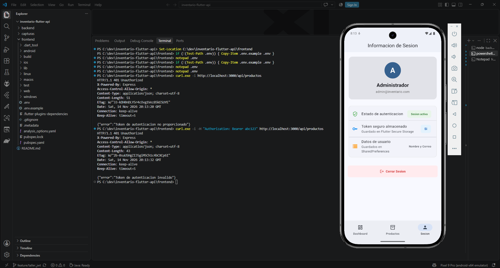

### Cierre de sesión (escenario 7)
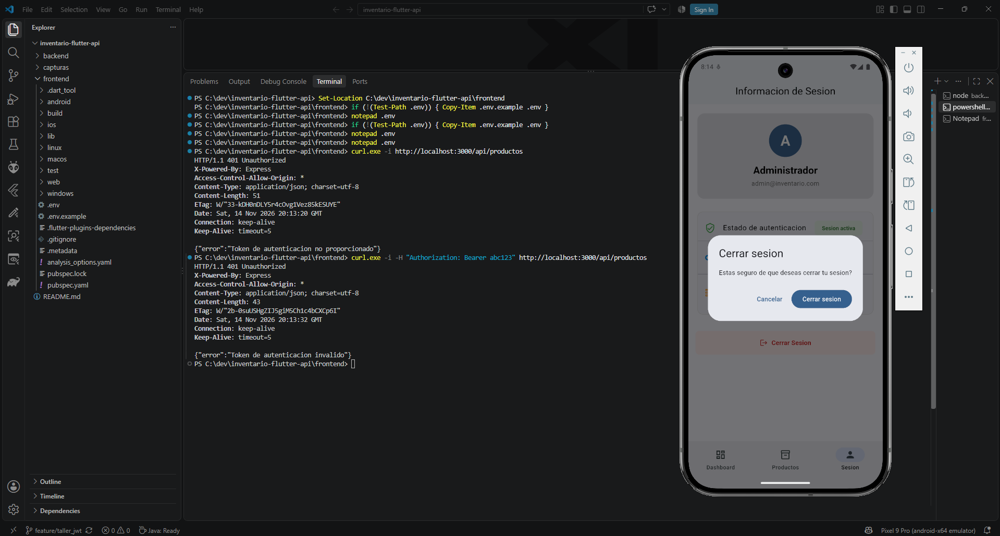
